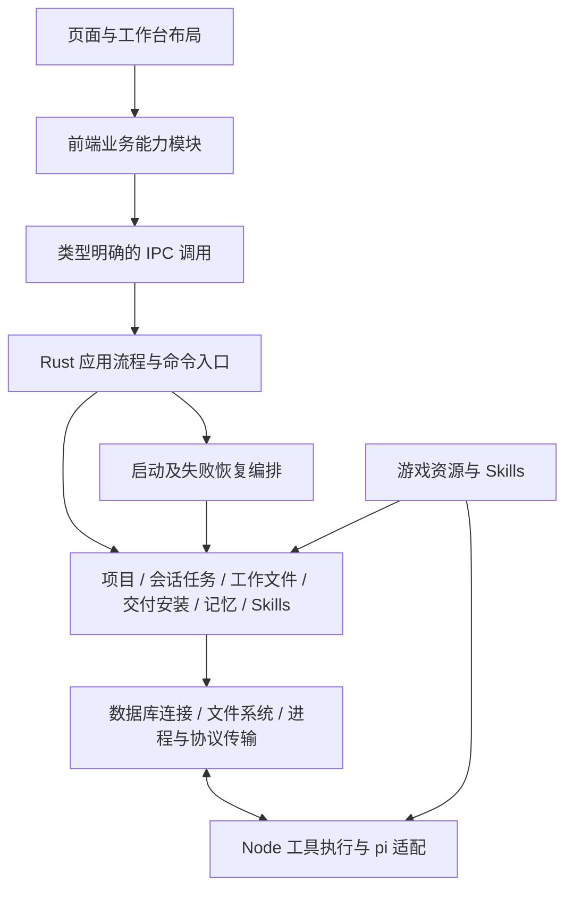

> 原始方案与修订历史。下文“尚未实施”等状态属于方案发布时基线；实施结果与未验收范围见[本轮整合记录](verification/2026-11-12-project-optimization.md)。

# GenMod 项目整体优化方案

日期：2026-11-11。

最近修订：2026-11-12，依据对抗审核补齐运行时消费者、跨能力刷新归属与首会话草稿转移约束。

状态：方案已整理，代码优化尚未实施。用户已确认整体优化与局部清理属于同一范围；本次授权为将方案写入 docs，不代表已授权执行代码重构、删除、测试或发布。

分析基线：`e125e3c7b4927f3c52fef7df94c833adb74640fb`。编写前工作区干净。后续执行必须重新检查当前源码和差异。

## 1. 目标与已确认边界

目标是让代码容易定位、业务职责清晰、数据变更可追踪，同时清除重复实现、闲置文件和过期说明。架构重整与小范围清理一起纳入计划，不以删除几个资源或提取几个函数代替整体优化。

用户已确认：

- 盘点覆盖 Vue 前端、Rust 后端、Node 运行时、资源与 Skills、构建脚本和文档。
- 登录和云端更新暂时保留，不因没有当前界面入口而删除；本地及已下载官方 Skills 的读取能力保留。
- 版本操作是明确可落地的局部优化，可以先实施；会话核心也必须纳入整体优化，不能长期搁置。
- 当前说明集中维护，历史设计、计划及验证记录归档保留，迁移时修正链接。
- 本地生成物和工作资料单独盘点，不纳入自动删除范围。
- 性能不是本轮无条件重写的理由，只有出现具体证据时安排相应优化。

执行约束：

1. 保持当前页面、交互、数据含义与协议行为；涉及产品规则变化的方案需另行明确。
2. 保留任务恢复、提交结果确认、工作区租约、路径校验、锁顺序、事务及失败补偿，不以“简化”为名删除。
3. 不新增依赖、通用插件框架、全局事件总线或另一套状态管理体系。
4. 不删除本机数据库、MOD 工作目录、安装记录、凭证、缓存或玩家游戏文件。
5. 不自动运行测试或启动应用；跨项目类型检查、编译和构建按项目规则确认范围后执行。
6. 不自动提交、推送、发布或派遣子代理；方案按主代理可顺序完成的工作组织。
7. 沿用[兼容清理方案](superpowers/plans/2026-11-11-compatibility-cleanup.md)中的明确保留项，不重新把当前正常缺省、中断恢复和 Skills 选择行为当作旧兼容代码清理。

## 2. 现状判断与证据边界

本轮已检查入口、主要模块、会话与任务链路、版本操作、存储关系、资源与构建配置、文档入口。以下是结构问题及改进机会，不是全部经过运行复现的功能缺陷。尚未完成全仓逐文件的闲置判定。

| 方向 | 当前源码证据 | 维护影响 | 优化目标 |
| --- | --- | --- | --- |
| 会话接口 | `src/stores/session.ts` 公开大量可写运行时字段、client 和 runtimes；页面直接改 task、readOnly、uiRequest、artifactRevision | 页面必须了解内部状态和更新顺序 | 以只读状态及明确业务操作访问会话 |
| 任务编排 | `src-tauri/src/pi/bridge.rs` 同时编排项目检查、Skills、记忆快照、租约、进程及任务状态 | 通信变化与业务流程变化集中在同一位置 | 分离任务流程、进程通信及事件处理 |
| 数据职责 | `storage/repository.rs` 引用任务、生命周期、项目记忆、交付模块；数据库初始化执行业务恢复 | 存储基础设施与业务相互依赖 | 明确存储基础能力、领域仓储及启动恢复编排 |
| 聚合读写 | `ModProject` 汇集项目、会话、版本和安装信息；通用保存同步 sessions | 局部操作需要考虑整份聚合数据 | 保留组合读取，按所属业务约束写入 |
| 前端组织 | mods 混合项目、版本、安装及调查；workbench 混合布局、文件、日志、记忆和版本 | 目录不能准确回答功能归属 | 按业务能力集中实现，工作台负责组合 |
| 局部重复 | ContextPanel 与 ModManagerPage 各自实现版本导出、删除、提示和确认弹窗 | 同一规则需多处同步 | 共用版本操作及确认界面，保留展示差异 |
| 协议维护 | TaskContext 在前端、Rust、Node 分别定义；工具请求使用字符串标题和 JSON | 修改协议需要人工同步多个位置 | 明确契约所有者、类型化业务调用与对应校验 |
| 游戏适配 | 游戏目录和 Skills 已数据化，安装提示仍在 Rust 按游戏 ID 分支 | 新游戏可能同时涉及资源和应用核心 | 游戏特有信息归入资源或能力声明 |
| 构建 | 运行时版本分布于 lock、依赖、Tauri 路径及 CI；准备运行时后 CI 恢复开发依赖 | 构建步骤及版本更新存在隐含配合 | 单一维护来源、显式阶段和一致性检查 |
| 文档与闲置文件 | 当前入口夹杂旧工作区状态；保留功能、退役代码与生成物需区别对待 | 易误判行为或误删文件 | 当前事实单独维护，历史可追溯，删除有证据 |

现有值得保留的基础：features 组织、shadcn-vue 组件、消息 reducer、独立 followupQueue/pendingSubmission、工作区租约、事务与 revision、安装预览、Skills 资源目录。优化优先收拢这些已有实现，不另建平行体系。

## 3. 目标架构与职责

### 3.1 总体关系



这是一张目标职责图，不要求每个框都新建一层目录或包装类。只在真实职责交叉处提取模块，不能用大量一行转发函数制造“分层”。

### 3.2 数据与状态归属

| 数据或状态 | 权威归属 | 前端职责 |
| --- | --- | --- |
| 项目、归档、版本、安装记录 | Rust 业务模块及本地持久化 | 展示快照、提交明确操作、更新查询结果 |
| 任务受理与终态 | Rust 提交及任务记录 | 展示确认结果，不以请求超时推断失败或未受理 |
| 活动进程、generation、工作区租约 | Rust 运行时管理 | 使用订阅和快照，不由页面伪造状态 |
| 会话消息与恢复后投影 | 持久历史、原生快照及前端 reducer | 按既有身份规则归并，不另造一套消息源 |
| 草稿、附件、待发送输入 | 现有持久机制及前端输入模块 | 保留编辑内容和不确定提交的恢复入口 |
| 选中项、弹窗、Tab、局部提示 | 对应视图或业务控制器 | 不写入后台任务状态 |
| 项目记忆与长期记忆 | 各自独立业务模块 | 保持作用域和用户编辑保护，不合并为通用记忆表单模型 |
| 文件、交付、记忆及反馈的刷新信号 | 所属能力管理数据与失效状态，应用协调入口转交跨能力通知 | 使用事件原项目/会话身份更新，不以当前选中会话替代结果归属 |

一次字段修改应有明确入口。公开只读状态不要求立即重写全部状态类型；先阻止页面直接写核心字段，再逐步缩小内部接口。

### 3.3 前端目标目录

以下为目标归属，按能力整组迁移，不先批量移动再补行为：

```text
src/
  components/ui/          通用 UI 基础组件
  contracts/              前端使用的跨端数据契约
  features/
    projects/             项目创建、资料、归档、删除
    sessions/             会话生命周期、运行状态、输入受理与恢复
    chat/                 消息、输入框、工具过程的展示与交互
    workspace/            MOD 工作文件、预览、编辑及变更
    delivery/             交付版本、详情、导出、安装
    project-memory/       项目记忆展示与操作
    knowledge/            长期记忆
    verification/         玩家反馈与确认
    games/                游戏展示及环境调查
    skills/               能力管理及保留的云端更新界面
    settings/             配置界面
    auth/                 暂保留登录实现
    workbench/            布局、导航及能力组合
  services/               IPC 等跨能力传输基础设施
  stores/                 应用级选择、共享投影与必要协调
  lib/                    真正跨能力且无业务状态的辅助函数
```

- `useVersionActions` 最终归入 delivery，不长期放在 workbench；局部清理先落地时可暂放 mods，迁移时整体移动。
- sessionRuntime、followupQueue、pendingSubmission 归 sessions；pi client 和协议解析是否仍在 services/pi，以是否含会话业务规则区分，不为目录整齐重复实现。
- 文件浏览器、文件操作 composables、源码差异归 workspace；ContextPanel 只组合子面板。
- ProjectPage、NewModDialog、ArchivedProjectsDialog、RemoveProjectDialog 归 projects；版本界面归 delivery；GameIcon/GameCover/GameInspectionPanel 归 games。
- 单个能力内部先采用简单平铺；只有组件、状态、协议文件确实形成独立职责时再建子目录，不统一套空目录模板。
- 不要求所有页面直接依赖所有模块；跨能力通过明确导出接口协作，不穿透另一能力的内部可写状态。

### 3.4 Rust 与 Node 的目标职责

- Rust `application`：承载确实跨模块的任务启动、项目创建/删除协调、启动恢复顺序。领域内部简单命令仍可在所属模块，不强制全部绕一层。
- Rust `pi`：进程与订阅管理、RPC 传输、事件解析；任务身份、受理和执行流程有明确子模块。bridge 保留必要适配入口，不继续集中所有业务。
- Rust `storage`：数据库连接、基础路径、序列化等通用能力。项目/会话/交付的仓储逐步归到所属模块；恢复由应用入口编排，不由数据库连接层反向触发所有业务。
- Node `extensions`：按工具职责组织。将 commands.ts 中的任务上下文与通用诊断从命令执行逻辑分离，使记忆、调查等工具不因获取 context 而依赖命令执行模块。
- Node 与 Rust 的执行校验继续各司其职。跨进程重复验证不等同于无用重复；原生仍校验身份、路径、权限及交付证据。

## 4. 工作包与实施顺序

所有工作包属于同一优化范围。分批是为了维持可检查、可回退的中间状态，不表示只完成第一批就结束整体优化。

### P0：建立当前覆盖与变更基线

主要位置：根入口、`src/router`、`src-tauri/src/lib.rs`、`runtime/extensions/mod-tools.ts`、`scripts`、`docs`。

- [ ] 更新 Git 基线并区分已有改动，核对 CodeGraph 索引状态。
- [ ] 按本方案十个方向记录已检查文件、候选问题和结论；不把一次查询当全量覆盖。
- [ ] 为每个准备移动或删除的文件核对导入、路由、命令注册、动态路径、构建复制、资源清单、测试及文档引用。
- [ ] 将候选归为在用、暂保留、确认闲置、生成物、历史资料；无法证明闲置的文件不删除。

产出：覆盖记录及本批实际变更清单。若需要独立任务追踪文件，按 `.scratch/<feature>/` 约定并在获授权后建立；本方案本身保留在 docs。

### P1：闲置清理与版本操作收拢

主要文件：`src/features/mods/ModManagerPage.vue`、`src/features/workbench/ContextPanel.vue`、`InstallDialog.vue`、`ArtifactPanel.vue`、`VersionActions.vue`。

- [ ] 复核后删除 `src/assets/vue.svg`、`public/vite.svg`、`public/tauri.svg`。本轮限定搜索未发现使用，HTML 当前使用 gen-mod-icon.png；执行时再次核对。
- [ ] 核查其他退役链路及空目录，不按文件名、日期或零静态引用机械删除。
- [ ] 新增业务专用 `useVersionActions.ts`，收拢导出、打开版本目录、删除及相应结果处理；复用已有 nativeCall，不另建通用 CRUD 框架。
- [ ] 新增 `DeleteVersionDialog.vue`，合并重复确认界面；已有安装与详情弹窗继续复用。
- [ ] 操作绑定发起时的项目和版本，结果更新对应项目；项目切换后不得覆盖新项目的局部提示和选择。
- [ ] 保留版本页删除后选择最新版本、侧栏删除后清空选择的差异；取消导出不提示成功，删除失败后重新读取项目以覆盖部分完成状态。
- [ ] 只读限制、目标目录记忆、安装结果刷新和已安装标记的语义保持。

完成标准：两个入口使用同一业务操作实现；UI 差异显式保留；删除仅限已核实文件；登录与云端更新链路无改动。

### P2：收紧会话接口与统一状态变更入口

主要文件：`src/stores/session.ts`、`src/services/pi/sessionRuntime.ts`、`client.ts`、`reducer.ts`、`followupQueue.ts`、`pendingSubmission.ts`，及 chat/workbench/mods 中的直接消费者。

- [ ] 列出当前所有外部可写字段和实际写入位置，按运行事实、输入状态、展示状态划分。
- [ ] 页面使用明确操作管理附件、回应扩展请求、刷新项目结果、查询项目忙碌状态，不直接修改 task、client、runtimes 或刷新计数。
- [ ] store 负责会话选择与存续；runtime 负责单会话行为；消息 reducer 负责投影；输入队列及待确认提交沿用已有模块。
- [ ] 将项目级文件、交付、记忆及反馈的刷新交给所属能力；跨能力事件由应用协调入口按原 modId、sessionId 转交。保留现有增量机制，不新增全局事件总线，也不只把刷新计数的直接赋值包装成 setter 就视为完成职责调整。
- [ ] 区分项目数据刷新与当前视图更新：后台会话的结果仍更新原项目，页面切换后不把旧事件或异步结果写入新项目；同项目不同会话共享的项目数据按所属能力同步。
- [ ] 将恢复、输入受理协调和运行状态归并分离为内部职责，保持对调用方简洁的接口，不导出全部内部函数。
- [ ] 逐一迁移所有消费者，删除失去用途的可写代理，不长期保留新旧两套入口。
- [ ] 保持按项目/会话隔离、后台任务继续、重开恢复、generation 过滤、提交身份关联及停止后的队列暂停行为。

完成标准：页面不再依赖运行时集合和传输 client 的内部结构；能通过业务操作完成现有行为；每类状态能指出唯一变更入口或明确的同步规则；项目级刷新有明确业务所有者，不依赖当前选中会话，切换页面不丢失或串写后台结果。

### P3：任务编排与 Rust 依赖整理

主要文件：`src-tauri/src/pi/bridge.rs`、`manager.rs`、`runtime.rs`、`sessions.rs`、`submissions.rs`、`task_tools.rs`、`workspace.rs`、`tasks.rs`、`src-tauri/src/lib.rs`。

- [ ] 为启动、停止、恢复、会话删除列出步骤、锁顺序、持久化时点和失败补偿；以当前实现为基线。
- [ ] 从 bridge 提取进程启动/退出和协议事件处理，将跨领域任务准备协调移入应用流程；优先复用已有 pi 子模块，避免新增同职责文件。
- [ ] 保持 preparing 记录与快照、提交绑定的事务关系；bootstrap 成功后才发送需求；失败和取消不降级启动。
- [ ] 工具分发只负责协议校验及转交，领域规则仍归记忆、交付、调查等模块。
- [ ] 关闭任务和删除项目继续协调进程、工作区和文件恢复，不缩减安全检查。

完成标准：修改传输协议不必修改项目业务编排；任务流程的阶段及失败出口能集中检查；没有为拆分扩大 pub 接口或暴露锁的内部结构。

### P4：聚合读取与业务写入分离

主要文件：`src-tauri/src/storage/repository.rs`、`models.rs`、`mods.rs`、`database.rs`，以及 `project_lifecycle`、`project_context`、`artifacts`、`install` 的调用方；前端对应 `contracts/mod.ts` 与项目查询。

- [ ] 保留 ModProject 作为兼容当前界面的组合读取结果，先不迁移数据库结构。
- [ ] 按项目资料、会话、版本、安装信息明确写入所有者；为真实局部修改建立所属业务操作，减少无关 sessions 同步。
- [ ] 显式保留当前 save_on 的初始草稿接管规则：无会话项目创建首个会话时，在同一事务内将项目初始草稿转入首会话，并清除项目中的初始草稿；失败则整体回退。后续创建会话、修改标题或版本不得重复转移或清空已有会话草稿。
- [ ] 数据修改仍使用当前事务、revision 和项目可写检查，不能以局部写入绕过并发保护。
- [ ] 数据库初始化仅处理数据库自身准备；应用启动入口按既有必要顺序协调删除恢复、任务中断标记、提交确认及文件恢复。
- [ ] 通用 storage 不再依赖 bridge 内部实现；共享身份计算归到双方都可依赖且职责明确的位置。
- [ ] 保留跨模块必须原子的操作，不为了依赖图美观拆散事务。

完成标准：局部业务操作不要求调用方修改完整项目快照；读取聚合与写入职责可区分；首会话草稿接管及事务语义保持；未引入数据库格式变化或重置要求。

### P5：按能力完成目录迁移与跨端契约整理

依赖：P1、P2 的接口归属明确；Rust 契约整理与 P3、P4 协调。

- [ ] 按 3.3 节迁移项目、交付、文件、会话、游戏及项目记忆文件，同批更新路由、导入、文档和测试路径。
- [ ] 将 ContextPanel 中的产物、日志、变更等独立区域交给所属能力面板；workbench 保留布局和选择。
- [ ] 明确每个 IPC 命令的参数及返回结果，业务代码不再随意以 nativeCall<T> 自行声明契约；不要求对无业务逻辑的调用增加多层转发。
- [ ] 分别整理 IPC、运行时事件、工具请求的命令名、数据结构、错误及身份字段；记录 Rust、前端、Node 的对应位置。
- [ ] 将 Node 任务上下文读取、诊断与命令执行分离；不从前端目录导入运行时协议以形成反向耦合。
- [ ] 优先使用已有类型和校验能力；类型生成或共享包仅在独立论证并获依赖/结构调整授权后采用。
- [ ] 同步 vitest.config.ts 的显式 include，确保迁移后的现有测试仍会被发现，不通过删除测试解决路径问题。

完成标准：目录能定位业务所有者；跨端字段有明确维护对应表；核心业务代码无需穿透其他能力内部状态；迁移无遗留旧导入。

### P6：游戏适配与构建资源治理

主要文件：`resources/games/catalog.json`、`skills/registry.json`、相关游戏 Skills、`src-tauri/src/artifacts/registry.rs`、`runtime/runtime-lock.json`、`runtime/package.json`、`scripts/prepare-runtime.mjs`、`scripts/build-app.mjs`、Tauri 配置及 `.github/workflows/release-windows.yml`；实际运行时消费者包括 `src-tauri/src/pi/runtime.rs`、`src-tauri/src/pi/sessions.rs`、`src-tauri/src/pi/bridge.rs`。若 P3 已迁移这些入口，核对其新位置，不按旧文件清单漏查。

- [ ] 将游戏特有的目录提示归入现有游戏资源或能力元数据，保留通用安装路径和交付安全校验在 Rust 中。
- [ ] 校验游戏清单、Skills 注册、图片路径、支持状态和打包资源之间的一致性；不开放未适配游戏。
- [ ] 以 runtime-lock.json 维护内置 Node/pi 运行时版本目标，其他必须存在的声明通过生成或一致性校验约束；CI 宿主 Node 与内置 Node 的用途分别注明。
- [ ] 同步实际启动消费者：runtime.rs 中的 Node/pi CLI 路径、bridge.rs 中的 mod-tools.ts 扩展入口、sessions.rs 中的 Node/read-session.mjs 历史读取入口。由同一版本配置解析路径，或建立覆盖全部消费者的一致性校验，避免新资源已打包而启动仍使用旧路径。
- [ ] 保持 package.json 为应用版本来源，明确 build-app 会同步 Cargo/Tauri 配置的写入行为。
- [ ] 明确 prepare、build、collect 阶段及副作用，保留当前 pnpm --legacy 部署和开发依赖恢复机制，不能当历史兼容直接删除。
- [ ] 为生成内容建立生命周期说明，区分可重建资源、发布产物、失败现场和人工工作资料；不对 output、work、build-output 或 runtime/resources 新增批量清理。保留 prepare-runtime.mjs 已有的受控退役文件清理；本轮若移动或删除运行时源文件，逐项检查增量输出中的旧副本，明确受影响文件及受控处理方式，不扩大为整个生成目录删除。

完成标准：新增已适配游戏不需要为显示提示添加 Rust 游戏名分支；运行时升级不会依靠人工记忆同步所有路径；CLI 启动、工具扩展加载和历史 helper 读取均与包内资源一致，不能仅以文件已打包代替运行入口验证；构建副作用明确可查。

### P7：文档归档与全范围收尾

主要文件：`docs/README.md`、`docs/project-context.md`、`docs/architecture/`、历史根目录设计、`docs/superpowers/`、`docs/verification/`。

- [ ] 当前项目上下文只保留当前产品规则、约束、入口和未验证事项；删除失效的“当前未提交”等状态描述。
- [ ] 当前架构说明与实际落地结构同步；旧架构图未重绘时标明历史版本，不宣称最新。
- [ ] 逐份按内容及状态判断归档，历史资料迁入 docs/archive 下对应分类；仍用于当前决策的文档保留可见入口，不能仅因日期旧而归档。
- [ ] 同批修复迁移文件的内部相对链接及仓库内入链；历史链接或外部引用无法更新时提供归档索引或必要的路径说明。
- [ ] 术语只有在业务含义确认后进入 GLOSSARY；文件组织细节和进度不进入术语表。重大、难逆且有真实取舍的决策才记录 ADR。
- [ ] 核对 P0 覆盖记录，集中报告所有已确认问题、未决候选和验证缺口，不以完成局部去重宣称整体完成。

完成标准：当前说明与历史证据清晰分开；本轮全部方向有处理结果或明确未完成原因；没有待删除、待迁移的新旧双份实现。

## 5. 依赖、迁移与回退

推荐顺序：P0 → P1 → P2 → P3 → P4 → P5 → P6 → P7。文档和清理随每个工作包同步，P7 做最终核对；P6 中独立的资源盘点可提前，不要求等待所有重构结束。

每个工作包都应保持可独立检查的完整调用链：先确认接口及消费者，再迁移实现、消费者与直接相关说明，最后移除旧入口。不能只提交新文件并让调用方长期留在旧实现。

- 目录迁移与大量行为改写分开组织差异，便于检查是否只是移动。
- 文件移动不自动重排全部代码、格式化整个目录或修改无关注释。
- 不将项目现有所有 source 命名机械改成 workspace；本方案的 workspace 指 MOD 工作文件能力，避免与 pi 的工作区租约职责混淆。
- 回退以本批源文件和配置变更为单位，不依赖清空数据库或删除玩家文件。
- 发现必须改变持久化格式、协议行为或安全边界时，集中说明理由和影响并确认，不能隐藏在目录整理中。

## 6. 验证方案与验收场景

本节列出实施后的验证要求，不表示本次已执行，也不构成自动运行测试的授权。

### 6.1 静态检查

- 每批核对 `git diff --check`、实际 diff、旧路径引用及全部消费者。
- 修改前读取脚本；限定 ESLint 可使用 `pnpm exec eslint <本批实际文件列表>`，不使用自动修复扫描全仓。
- 当前 `tsconfig.json` 覆盖整个 src，`pnpm exec vue-tsc --noEmit` 属于项目级检查；先说明收益并获确认。不能将逐文件 tsc 当成相同验证。
- `cargo check --manifest-path src-tauri/Cargo.toml` 编译整个 crate，不能声称仅检查改动文件；确认范围后执行。
- 当前前端 tsconfig 不覆盖 runtime/extensions；前端类型检查通过不能证明 Node 工具正确。Node 扩展需单独检查协议及实际打包包含情况。
- 源文件变动后按项目要求执行 `codegraph sync`、`codegraph status`；索引维护不替代类型检查或运行验证。

### 6.2 获授权后优先验证的行为

| 范围 | 具体场景及预期 |
| --- | --- |
| 版本操作 | 版本页和侧栏执行同一操作；取消导出；删除失败但记录已变化；操作中切换项目；各自选择行为保持 |
| 会话选择 | 任务运行时离开并返回；切换其他会话；后台消息继续归入原会话 |
| 跨能力刷新 | 后台会话产出文件、版本、记忆或反馈更新时切到其他项目，结果只更新原项目；同项目不同会话仍能看到共享项目数据的变化，旧异步结果不覆盖新视图 |
| 输入受理 | 响应丢失但任务已受理；重复确认不重复启动；待确认输入可恢复；队列失败或停止后不自动继续 |
| 任务准备 | bootstrap 失败、超时、取消均不发送需求；准备失败可正确回收状态和进程 |
| 项目写入 | 修改标题不覆盖版本/安装信息；陈旧 revision 拒绝；会话变化不丢失其他项目数据 |
| 首会话草稿 | 无会话项目已有草稿，创建首会话后内容原样可读且项目初始草稿清除；事务失败时两者不发生部分迁移；再次创建会话、修改标题或版本不转移或清空已有会话草稿 |
| 生命周期 | 归档禁止写；删除遇到失败保持恢复记录；跨项目长期记忆和已安装文件保留 |
| 资源与游戏 | 内置、已下载官方 Skills 按现有规则选择；不同游戏安装提示正确；缺资源明确报错 |
| 构建 | 干净准备与重复准备；运行时版本一致；发布包包含所需扩展、Skills、图片；运行时源文件迁移后增量输出无本轮退役旧副本；构建输出不混入源文件 |
| 运行时入口 | 在已准备或打包的资源上分别验证 Node/pi CLI 启动、mod-tools.ts 工具扩展加载、read-session.mjs 历史读取；升级版本后的三个入口均指向对应新资源，不只验证文件存在 |

现有 `sessionRuntime.test.ts`、`client.test.ts`、`reducer.test.ts`、`useSourceFileActions.test.ts` 及 Rust 各模块测试是优先复用对象。只有真实接口和行为变化需要时才补充有意义的用例；不为简单文件移动、模板资源删除编写镜像测试。

运行测试需用户明确授权；构建安装包、启动桌面应用、调用模型和游戏内验证分别确认与报告。无真实运行证据时，交付结论必须标记静态核对范围。

## 7. 整体验收标准

- [ ] 代码、目录、闲置文件、资源、构建和文档均完成约定覆盖，不能只交付其中一部分后称整体优化完成。
- [ ] 会话消费者通过明确操作交互，不直接依赖可写核心运行状态或内部进程 client。
- [ ] 项目级刷新按原项目/会话身份进入所属能力，后台结果不依赖当前选中会话，不串写其他项目。
- [ ] 任务业务编排与进程通信职责可区分，锁、事务、身份和恢复机制保持。
- [ ] 聚合读取与所属业务写入可区分，不依赖整份 DTO 修改无关数据。
- [ ] 首会话在同一事务中接管初始草稿，后续会话及无关更新不重复迁移或清空已有草稿。
- [ ] 版本重复逻辑与重复弹窗已收拢，既有交互差异保留。
- [ ] 前端能力目录与实际职责一致，协议、资源和生成物有明确所有者。
- [ ] 运行时配置、打包资源与 CLI、扩展、历史 helper 三类实际消费者一致；未执行的运行入口验证单独列为未验收。
- [ ] 闲置删除附入口、调用、资源及打包核查依据；暂保留功能和用户资料未误删。
- [ ] 文档反映最终结构，历史记录可追溯，相对链接有效。
- [ ] 每项检查报告实际命令、结果和未覆盖范围；没有把静态检查写成集成或游戏验收通过。

## 8. 本次方案编写记录

本次仅创建本方案。事实依据为当前源码、Git 状态、配置和文档的只读检查及 CodeGraph 查询。未修改业务代码、删除文件、安装依赖、运行测试、类型检查、构建或应用，也未提交或推送。

方案中的目标目录、模块接口和工作包属于建议设计；结构事实不等同于已复现缺陷，候选闲置文件需在实施时按最新状态复核。

### 2026-11-12 对抗审核修订

- 补齐 P6 的三个 Rust 运行时消费者，将 CLI、工具扩展、历史 helper 纳入路径治理和验收。
- 明确 P2 跨能力刷新归属、原项目身份及后台结果同步约束，避免仅包装刷新计数而保留职责混杂。
- 明确 P4 首会话草稿接管的事务行为及重复创建、无关写入时的保留要求。
- 澄清生成目录不新增批量清理与已有受控退役清理的区别，并要求核对运行时文件迁移后的增量旧副本。
- 同步第 3、6、7 节的状态归属及验收要求。本轮仅修订方案，未实施代码优化或运行测试、构建、应用。
