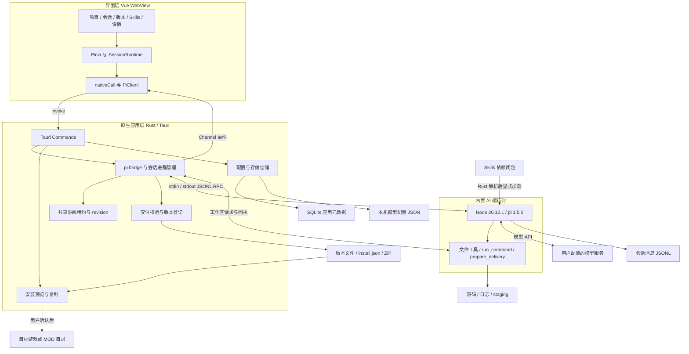
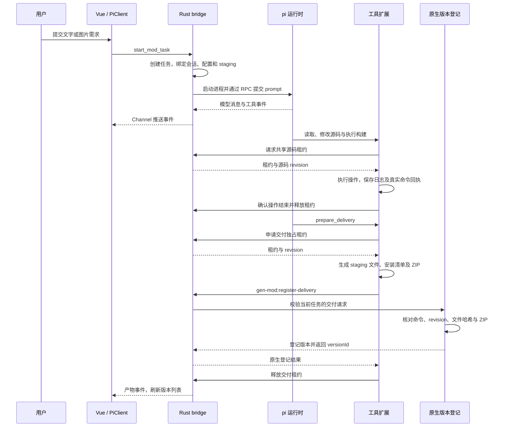
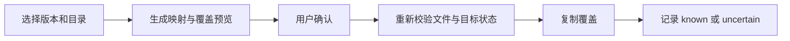

# GenMod 项目架构

GenMod 是基于 Vue 3 和 Tauri 2 的本地 AI MOD 工作台。用户通过会话提出开发需求，Rust 原生层管理项目、任务和运行时，内置 pi 调用模型并通过工具开发源码。交付文件经过原生校验后形成版本，用户确认安装预览后再部署到指定目录。

本文描述 2026-10-11 当前工作区实现，包含尚未提交的变更，不等同于已有安装包的功能范围。

- [交互式架构图](./gen-mod.html)：可缩放、切换主题并导出图片。
- [架构图源文件](./gen-mod.architecture.json)：后续调整图中的模块和关系。

## 1. 总体架构

系统分为界面、原生应用、AI 运行时与工具、能力资源、本地存储五部分。应用没有独立部署的业务服务端；模型 API 由用户配置，可以连接远程或本地模型服务。



交互式图保留主要模块关系；上图展开通信方向和数据边界。租约属于应用内部协作机制，Windows Job 负责进程树管理，不应把二者描述成操作系统级文件沙箱。

## 2. 模块职责与代码位置

| 模块           | 职责                                                            | 主要代码                                                           |
| -------------- | --------------------------------------------------------------- | ------------------------------------------------------------------ |
| 页面与工作台   | 项目选择、聊天、源码只读浏览、版本安装、Skills 与模型设置       | `src/features/`、`src/router/index.ts`                             |
| 项目与会话状态 | 按项目与会话保存运行状态；切换页面不结束后台任务                | `src/stores/projects.ts`、`src/stores/session.ts`                  |
| 会话客户端     | 发起任务和引导输入，匹配 RPC 请求，按身份与 generation 过滤事件 | `src/services/pi/client.ts`                                        |
| 消息归并       | 将流式事件转成聊天内容、活动状态和产物刷新信号                  | `src/services/pi/sessionRuntime.ts`、`reducer.ts`                  |
| IPC 入口       | 注册前端可调用的原生命令，初始化数据库，退出时清理运行时        | `src-tauri/src/lib.rs`                                             |
| 运行时管理     | 维护会话槽、启动 pi、传递配置与任务上下文、接收事件、管理进程树 | `src-tauri/src/pi/bridge.rs`、`manager.rs`、`runtime.rs`、`job.rs` |
| 工作区协调     | 读写租约、排队、读取基线和源码 revision 校验                    | `src-tauri/src/pi/workspace.rs`、`runtime/extensions/workspace.ts` |
| 工具扩展       | 文件操作、程序与参数数组执行、命令回执、准备交付                | `runtime/extensions/mod-tools.ts`、`commands.ts`、`delivery.ts`    |
| 能力注册表     | 导入与启停能力，解析依赖、内容哈希与必要构建脚本                | `src-tauri/src/skills/registry.rs`、`skills/registry.json`         |
| 版本登记       | 核对任务、命令、文件与 ZIP，登记和删除应用内版本                | `src-tauri/src/artifacts/registry.rs`                              |
| 安装器         | 生成预览、确认后重新校验并复制，记录目标状态                    | `src-tauri/src/install/installer.rs`                               |
| 持久化         | SQLite 初始化、仓储、旧数据迁移、重启恢复与文件操作协调         | `src-tauri/src/storage/`                                           |
| 配置与文件访问 | 模型配置、源码浏览、差异、目录打开与 ZIP 导出                   | `src-tauri/src/config.rs`、`files.rs`、`changes.rs`                |

界面采用 Vue 3、TypeScript、Vue Router、Pinia、shadcn-vue / Reka UI、Tailwind CSS 4；消息渲染使用 markstream-vue，代码高亮使用 Shiki。Vite 负责前端构建，Rust/Tauri 负责桌面应用与本机能力。

## 3. 一次需求如何变成版本



`taskId` 标识本轮任务，`stagingId` 隔离本轮交付暂存；它们不会创建一份全新项目源码。后续任务继续使用同一项目的 `source/`。

版本成功以原生登记结果为准。`prepare_delivery` 需要本任务成功命令记录；能力声明 `requiredCommandScripts` 时，还必须有对应脚本的成功记录，交付源文件须位于 `.delivery/<taskId>/`。命令回执的源码 revision 必须与交付一致，文件内容与 ZIP 也必须一致。仅有助手成功回复或一个 ZIP，不代表版本已登记。

## 4. 多会话与共享源码

前端以 `modId/sessionId` 管理 SessionRuntime；Rust 以同样的项目与会话身份管理独立运行槽。不同会话可以并发运行，各自保留消息、任务和进程状态；同项目会话共享一份源码目录。

为避免并发覆盖，文件工具通过原生工作区申请租约。读取类操作可共享，写入、命令和准备交付使用独占租约。修改前的读取基线已过期，或等待期间源码发生变化时，操作会被拒绝，需要重新读取和判断。交付阶段再次校验源码 revision。

通信事件携带 `modId`、`sessionId`、`generation`，前端据此过滤其他会话和旧进程事件。运行中补充需求走 `steer_mod_task`，保持原任务身份；请求超时不自动重发。页面切换不会停止任务，重启应用也不会恢复旧进程或自动重放尚未确认的输入。

## 5. Skills 与模型配置

Skills 将游戏知识与通用运行机制分离。`skills/registry.json` 保存名称、分类、游戏 ID、版本、依赖、资源路径、输出排除目录及必要命令脚本。Rust 解析所选游戏能力的依赖闭包，再将能力显式加载给 pi。

当前内置能力为：

- `mod-workflow`：通用开发、命令执行、ZIP 与交付协议。
- `duckov-mod`：鸭科夫 API 资料、C# 模板和构建脚本，依赖 `mod-workflow`。

用户可以导入本地能力目录并启停；内容哈希用于识别能力上下文变化。上下文改变后旧会话只读，新会话加载新的能力；活动任务期间不能变更能力。

模型设置保存在 `appConfigDir/pi/models.json` 与 `settings.json`。启动任务时，Rust 读取配置并为 pi 创建只包含当前 provider 与模型的临时快照，Key 通过环境变量引用。正在运行的任务保持原配置，下次任务读取新配置。

API Key 在本机配置中明文保存，读取接口不返回已保存 Key；日志脱敏，命令子进程移除应用注入的 Key 等环境变量。这里是本机配置和进程环境控制，不是远程密钥托管服务。

## 6. 数据模型与目录

业务关系为“项目包含多个会话，会话包含多轮任务，任务可以产生版本，版本可对应多次安装记录”。项目与会话是长期上下文，任务是一次执行，版本是某次交付的固定产物。

SQLite 保存项目、会话草稿与偏好、任务、运行摘要、引导输入、会话统计、迁移及文件操作状态。版本与安装关联保存在项目数据中，不能将它们画成当前数据库中不存在的独立表。正式会话消息仍由 pi 保存为 JSONL。

```text
appLocalDataDir/
├── gen-mod.sqlite3
└── mods/<modId>/
    ├── source/                       所有会话共享的源码与开发资料
    ├── artifacts/<versionId>/
    │   ├── files/                    固定版本交付文件
    │   ├── version.json              任务、能力与文件哈希
    │   ├── install.json              相对路径安装映射
    │   └── mod.zip
    ├── logs/
    │   ├── sessions/*.jsonl           正式会话消息
    │   └── <taskId>/                  本轮任务与工具日志
    │       ├── runtime-events.jsonl
    │       ├── commands/<commandId>.log
    │       └── tool-results/
    ├── installations/                安装相关记录与历史备份资料
    └── mod.json                       旧迁移源，不再活动写入

appConfigDir/pi/
├── models.json
└── settings.json
```

应用启动先初始化 SQLite、迁移旧数据，再将上次遗留活动任务标记为中断并协调文件操作状态。SQLite 与文件系统不是一个原子事务，`file_operations` 用于记录跨两者的操作进度和恢复依据。

## 7. 安装流程与交付边界



安装预览令牌保存在 Rust 内存中。实际安装会重新计算清单并核对目标，预览后文件发生变化需要重新确认。当前实现直接复制覆盖，不创建新备份、不自动回退；部分复制失败可能将目标标记为 `uncertain`。

版本生成不自动触发安装，安装不自动启用游戏 MOD。“已安装”基于应用维护的已知部署记录，不代表持续检测了游戏目录，也不代表游戏内功能或兼容性已验收。

## 8. 运行与分发

开发时由 Vite 提供前端资源，Tauri 承载窗口与原生代码。发布时打包前端静态资源、固定版本的 Node、pi 及 Skills。Rust 显式选择应用自带的 Node，不回退到用户全局安装。

`scripts/prepare-runtime.mjs` 准备分发运行时；`src-tauri/tauri.conf.json` 定义前端构建入口和资源映射。用户运行工作台不需要全局 Node/pi；具体 MOD 编译仍可能需要用户提供 .NET SDK 和游戏参考程序集。

pi 以 RPC 模式承担执行；SDK 辅助只读历史读取，不作为另一套任务执行通道。模型请求来自 pi 进程，Vue 页面通过 Tauri IPC 与 Rust 交互。

## 9. 阅读入口与验证范围

建议依次阅读 `src-tauri/src/lib.rs`、`src/services/pi/client.ts`、`src-tauri/src/pi/bridge.rs`、`runtime/extensions/mod-tools.ts`，再按关注点进入工作区、版本登记与安装模块。

当前实现细节另见 [项目上下文](../project-context.md)，历史设计见 [初始设计](../2026-10-09-gen-mod-design.md)。历史文档与当前代码冲突时，以当前实现和已确认需求为准。

本次架构整理依据当前源码、配置与调用关系；未运行项目测试、构建、应用、真实模型调用或游戏验证。图形校验仅检查文档产物，不代表业务运行验收。
